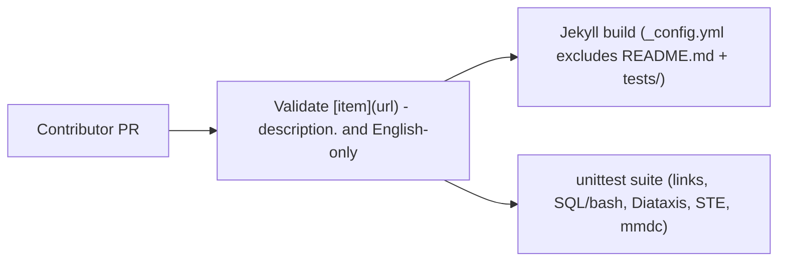

# awesome-mysql

A curated list of awesome MySQL free and open-source software, libraries, and resources (`gh-pages` fork of `shlomi-noach/awesome-mysql`).

> **Documentation Portal:** [docs/index.md](docs/index.md) ([Tutorials](docs/01-tutorials/index.md), [How-To Guides](docs/02-how-to-guides/index.md), [Reference](docs/03-reference/index.md), [Explanation](docs/04-explanation/index.md)) | [Site Landing](index.md) | [Contribution Guidelines](CONTRIBUTING.md)

## Fork Status and Curated Workflow

Upstream commit `6adf53e` replaced the `gh-pages` list with a stub pointing to `https://github.com/shlomi-noach/awesome-mysql`, while preserving the full `19`-category list at commit `ae5cf0a` in Git history.



## Selected Curated Tools (Formatted per `CONTRIBUTING.md`)

### Analysis & Benchmarking

- [Anemometer](https://github.com/box/Anemometer) - a SQL slow query monitor built by Box.
- [MySQLTuner-perl](http://mysqltuner.com) - a script that reviews MySQL configuration to improve performance and stability.
- [Prometheus mysqld_exporter](https://github.com/prometheus/mysqld_exporter) - a time-series exporter for MySQL server metrics.
- [Sysbench](https://github.com/akopytov/sysbench) - a modular cross-platform benchmark tool for MySQL and system load tests.

### Backup, Replication, and Operations

- [gh-ost](https://github.com/github/gh-ost/) - GitHub's triggerless online schema migration tool for MySQL.
- [MyDumper](https://github.com/maxbube/mydumper) - logical parallel backup and restore tool for MySQL.
- [orchestrator](https://github.com/outbrain/orchestrator) - a MySQL replication topology management and visualization tool.
- [Percona Toolkit](https://www.percona.com/software/mysql-tools/percona-toolkit) - a collection of command-line tools for MySQL administration tasks.
- [Percona XtraBackup](https://www.percona.com/doc/percona-xtrabackup) - an open-source hot backup utility for InnoDB and XtraDB servers.
- [sys](https://github.com/mysql/mysql-sys) - a collection of views, functions, and procedures for MySQL diagnostics.

## Verification

Run the automated documentation, Jekyll config, SQL/bash snippet, entry format, and Mermaid checks:

```bash
python3 -m unittest discover -s tests -p "test_*.py" -v
```

## License

Content is licensed under CC-BY-SA-4.0 and the Solo Jekyll theme under MIT ([`LICENSE.md`](LICENSE.md)).
