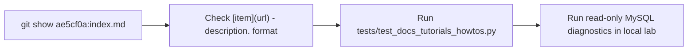

# Tutorial 1: Navigate Archived MySQL Tools and Validate SQL Diagnostics

In this tutorial, you inspect the pre-migration Awesome MySQL snapshot (`ae5cf0a`) stored in Git history, verify curated list formatting rules, and review safe diagnostic queries highlighted by tools in the list (`sys`, `Anemometer`, `Explain Analyzer`).

## Prerequisites

- `git` and Python 3 installed locally.
- Optional: local MySQL 8.0 / MariaDB sandbox container if executing SQL diagnostics interactively.

## Step 1: Inspect the Curated List Snapshot in Git History

Commit `6adf53e` stripped `index.md` on `gh-pages`, leaving the full `233`-line curated list accessible in parent commit `ae5cf0a`:

```bash
git show ae5cf0a:index.md | grep -E "^## |^# "
```



Expected top-level sections include `## Analysis`, `## Backup`, `## Benchmarking`, `## Connectors`, `## HA`, `## Proxy`, `## Replication`, `## Schema`, `## Security`, `## Server`, `## Sharding`, and `## Toolkits`.

## Step 2: Check Diagnostic SQL Snippets (`EXPLAIN` and `sys`)

Tools listed in `README.md` (`MySQL Explain Analyzer`, `sys`, `Percona Toolkit`) rely on standard MySQL metadata queries. In an isolated local MySQL instance, inspect query plans and schema metrics safely:

```sql
EXPLAIN FORMAT=JSON SELECT table_name, engine FROM information_schema.tables WHERE table_schema = 'mysql';
SELECT table_schema, count(*) AS table_count FROM sys.schema_table_statistics GROUP BY table_schema;
```

## Step 3: Run the Automated Validation Suite

Execute the Python verification suite to validate awesome-list formatting, `_config.yml`, relative links, SQL fences, and Mermaid diagrams:

```bash
python3 -m unittest discover -s tests -p "test_*.py" -v
```

Expected output: `OK` with zero errors.

## Next Steps

- Contribute or validate entries using [How to Validate and Contribute MySQL Entries](../02-how-to-guides/validate-and-contribute-mysql-entries.md).
- Review every category and Jekyll setting in [Categories, Jekyll, and Entry Specification Reference](../03-reference/categories-jekyll-and-entry-spec.md).
- Read curation background in [Curated List Design and `gh-pages` Layout](../04-explanation/curated-list-design-and-gh-pages.md).
