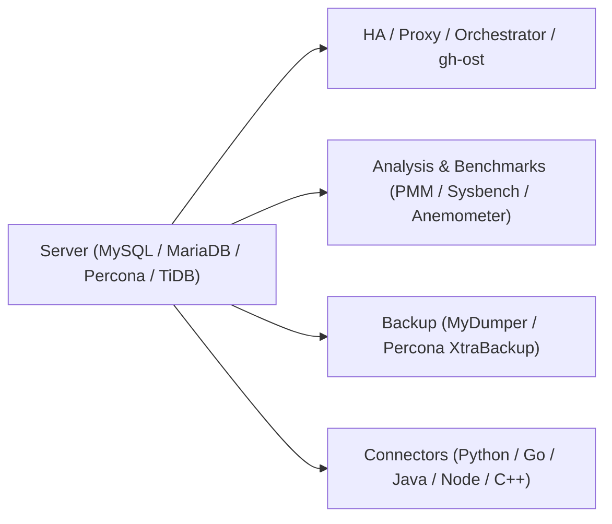

# Curated List Design and `gh-pages` Layout

Understanding how `gh-pages` history and the Solo Jekyll template interact prevents broken builds or misleading repository documentation.

## 1. MySQL Ecosystem Map and Upstream `gh-pages` Migration

In December 2018 (commit `6adf53e`), upstream `shlomi-noach/awesome-mysql` retired `gh-pages` and replaced `index.md` (`233` lines in `ae5cf0a`) with an `8`-line pointer to `master`. In this fork, `gh-pages` remains the default branch while `origin/master` stopped at commit `9aebf27` (2015). Surfacing `ae5cf0a` in Git history alongside verified formatted highlights keeps the fork both accurate and actionable.

## 2. Relative CSS Constraints in `_layouts/default.html`

`_layouts/default.html` references `css/normalize.css`, `css/syntax.css`, and `css/solo.css` using **relative paths without `site.baseurl`**. Root pages (`index.md`, `404.html`) resolve those stylesheets cleanly, whereas nested `docs/` Markdown files avoid `layout: default` so Jekyll renders root styles safely and `README.md` + `tests/` remain excluded in `_config.yml`.

## 3. Why Strict Entry Formatting (`[item](url) - description.`) Matters

Enforcing neutral lowercase descriptions, one link per project, FSF-open-source licensing, and exclusion of promotional slides stabilizes diffs and stops link/marketing sprawl across collaborative PRs.

- Full specification and category list: [Categories, Jekyll, and Entry Specification Reference](../03-reference/categories-jekyll-and-entry-spec.md).
- Contribution runbook: [How to Validate and Contribute MySQL Entries](../02-how-to-guides/validate-and-contribute-mysql-entries.md).
