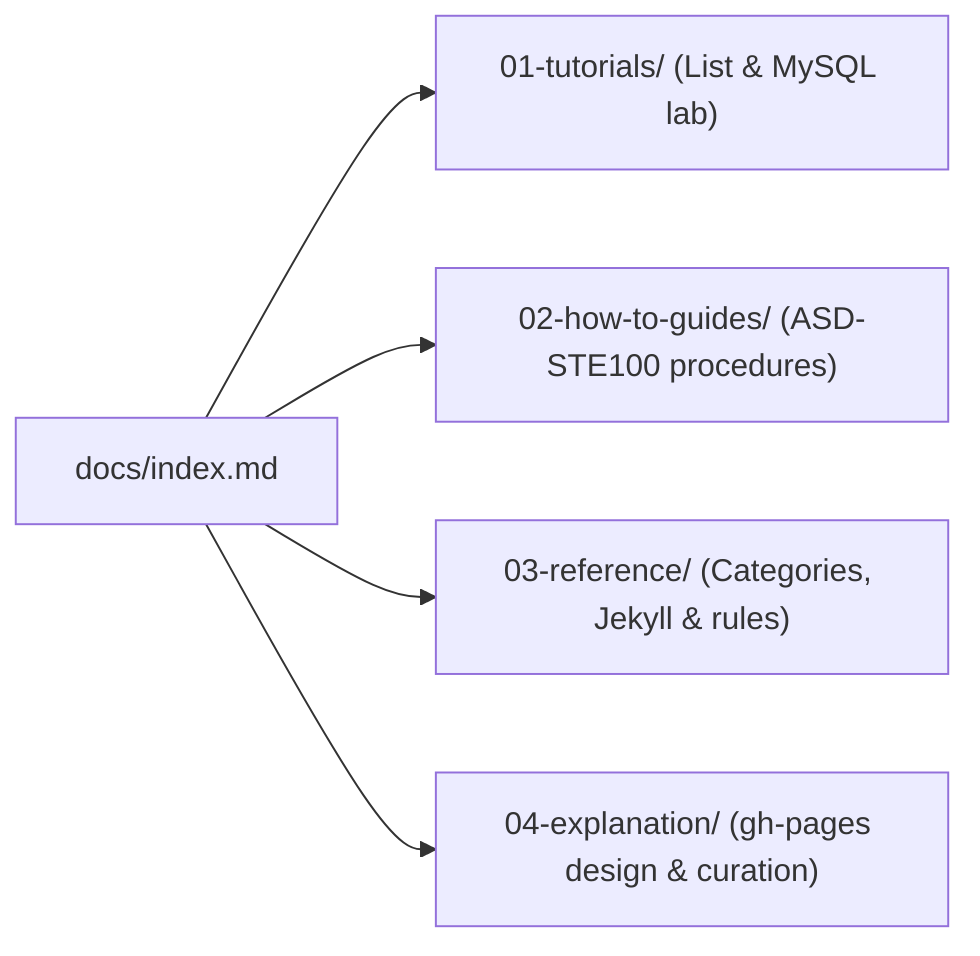

# Awesome MySQL Documentation Portal

Documentation portal for **awesome-mysql** (`gh-pages` fork), structured under the **Diátaxis** framework.

> **Repository Links:** [README.md](../README.md) | [Site Index](../index.md) | [Contribution Guidelines](../CONTRIBUTING.md)

## Quadrants

| Quadrant | Purpose | Entry Point |
| :--- | :--- | :--- |
| **Tutorials** | Inspect archived list history and verify SQL diagnostics locally | [01-tutorials/index.md](01-tutorials/index.md) |
| **How-To Guides** | Step-by-step entry verification and site checks (ASD-STE100 Issue 9) | [02-how-to-guides/index.md](02-how-to-guides/index.md) |
| **Reference** | Full category matrix, `CONTRIBUTING.md` rules, and Jekyll file inventory | [03-reference/index.md](03-reference/index.md) |
| **Explanation** | Curation rationale, alphabetical ordering, and `gh-pages` site layout | [04-explanation/index.md](04-explanation/index.md) |
